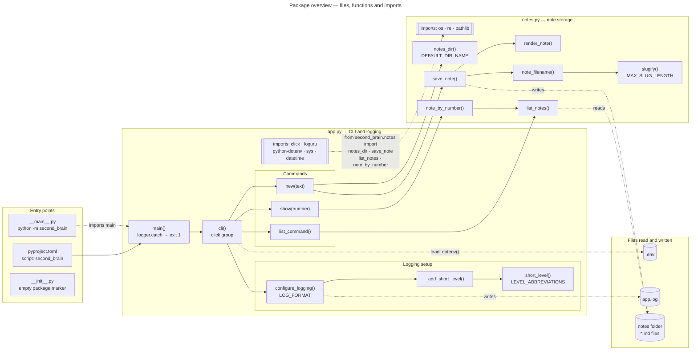
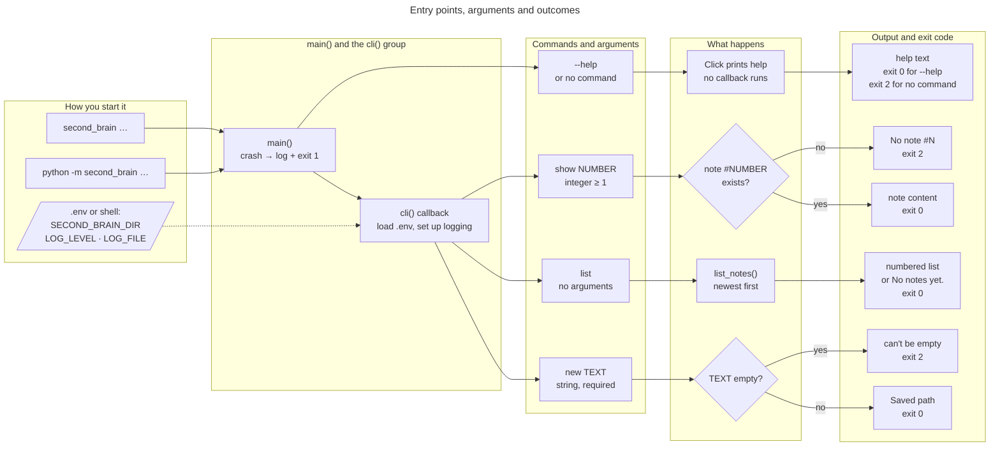
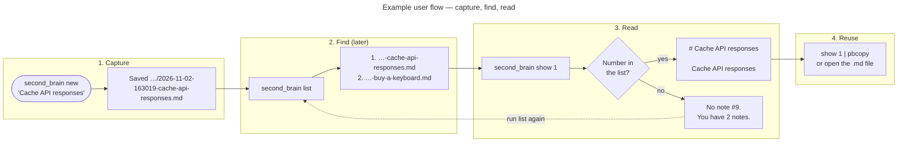

# Diagrams

Three views of `second_brain`: how the code is organized, how you call it, and what using it looks like day to day.

## 1. Package Overview

Every file and function in `src/second_brain/`, grouped into components.

- **Solid arrows** are function calls.
- **Dashed arrows** are imports between files, or files being read and written.
- **Double-bordered boxes** list what each file imports.

A few connections are left out to keep the chart readable:

- `list_command()` and `show()` also call `notes_dir()`, and `show()` also calls `list_notes()` to count the notes in its error message.

## 2. Entry Points and Arguments

The two ways to start the CLI, every command and argument, and what each one does, with its exit code.

`cli()` is a Click group, and its callback runs whenever a command is given, before that command's arguments are checked. `--help`, plain `second_brain` and unknown commands print help or an error without loading `.env` or setting up logging. A command's own `--help`, such as `new --help`, still runs the callback first. `show 0`, `show abc` and `show -1` are rejected by Click before `show()` runs, also with exit code 2.

## 3. Example User Flow

A typical session: capture an idea, find it again later, and read or copy it.

Numbers in `list` are newest first, so they shift by one every time you save a new note. If in doubt, run `list` again before `show`. With no notes yet, `list` prints `No notes yet.`, and `show` reports `You have 0 notes`.
